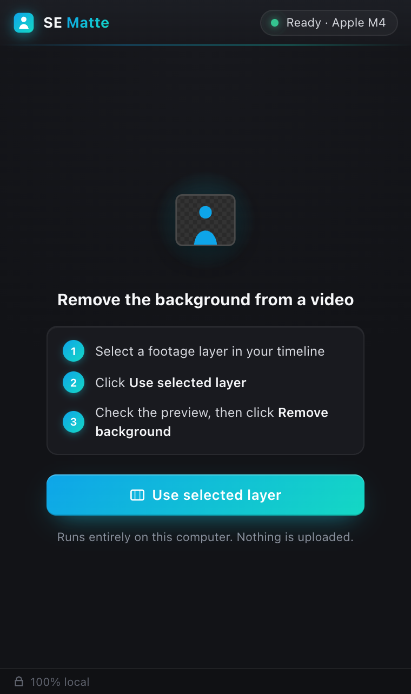
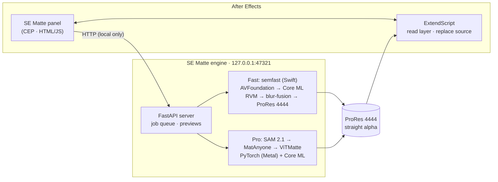

<div align="center">



# SE Matte

**AI background remover for Adobe After Effects – fully local, no green screen.**

Select a footage layer, check the preview, click **Remove background**.
SE Matte replaces the layer's footage with a clean cutout (ProRes 4444 with alpha) – no track matte,
no uploads, no subscriptions.


</div>

<br clear="right">

---

## Contents

- [Highlights](#highlights)
- [Two modes](#two-modes)
- [Performance](#performance)
- [Install](#install)
- [Using it in After Effects](#using-it-in-after-effects)
- [How it works](#how-it-works)
- [Project layout](#project-layout)
- [Engine CLI and local API](#engine-cli-and-local-api)
- [Development](#development)
- [Troubleshooting](#troubleshooting)
- [Roadmap](#roadmap)
- [Third-party models and licenses](#third-party-models-and-licenses)

## Highlights

- **One layer, in place.** The result replaces the layer's source footage (straight alpha), so effects,
  masks, transforms and timing on the layer stay as they are. *Restore original* puts the footage back.
- **Fast mode – no clicks.** People are found automatically. Runs on the Apple Neural Engine at
  ~48 fps for 1080p: a 2-minute vertical ad is done in about 1.5 minutes.
- **Pro mode – any subject.** Click what to keep (and Alt-click what to remove); SAM 2.1 tracks it,
  MatAnyone builds a soft, stable matte, ViTMatte re-solves every edge at full resolution.
- **Production edges.** Edge colours without background spill (blur-fusion foreground estimation),
  crisp outlines without fuzz, hair detail kept, no frame-to-frame flicker.
- **Live preview.** Overlay / Cutout / Original views that follow the AE playhead, and live
  Edge-look sliders (choke, feather, contrast) – the preview updates in a few milliseconds.
- **Background queue.** Keep working in AE while clips process; finished renders are applied to their
  layer automatically.
- **Private by design.** The engine listens on `127.0.0.1` only. After the one-time setup nothing needs
  the internet.
- **Rotated phone footage** (portrait clips with a rotation flag), **trimmed layers**, **time-stretched
  layers** and **any frame rate** (23.976 / 29.97 kept exactly) are handled.

## Two modes

| | ⚡ **Fast** | ◎ **Pro** |
|---|---|---|
| **Subjects** | People | Anything – people, pets, products, objects |
| **Input** | No clicks | Click to keep, Alt-click to remove, add corrections on later frames |
| **AI** | Robust Video Matting (ResNet-50) on Core ML / Neural Engine | SAM 2.1 → MatAnyone → ViTMatte edge refinement |
| **Speed (M4, 1080p)** | ~48 fps Standard · ~27 fps Max | ~1.75 fps Standard · ~0.7 fps Max |
| **Best for** | Talking heads, ads, interviews, long clips | Fine hair, unusual subjects, hero shots |

**Quality** – *Standard* is the everyday setting; *Max* doubles the AI's internal resolution for the finest
hair and the fewest stray background bits.

## Performance

Measured on a MacBook with Apple M4 (16 GB), 1080×1920 footage:

| Clip | Fast · Standard | Fast · Max |
|---|---|---|
| 600 frames (20 s) | 15 s | 24 s |
| 2:19 vertical ad (4,185 frames) | ~1.5 min | ~2.6 min |
| 10-minute clip at 30 fps | ~6 min | ~11 min |

Output is ProRes 4444 with straight alpha – about **0.7 MB per 1080p frame** (a 2-minute clip ≈ 3 GB).
The engine checks free disk space before it starts.

<details>
<summary><b>Why Fast mode is fast</b></summary>

- Decoding, AI, edge cleanup and encoding run as a pipeline: hardware decode (AVFoundation) → Core ML on the
  Neural Engine → Core Image / vImage → hardware ProRes encoder, each on its own queue.
- The Core ML model only runs RVM's low-resolution pass. The frame is downsampled natively with PyTorch-exact
  bilinear sampling, and the model returns the deep guided filter's coefficients *A, b* at low resolution.
  The full-resolution alpha (`A · mean(RGB) + b`) is computed on the CPU in parallel with the next prediction.
  This is 1.6× less Neural Engine time than running the whole network, with identical alpha
  (mean difference 0.003 / 255).
- RVM's own foreground colour is never computed: edge colours come from blur-fusion, which is both faster and
  sharper.
</details>

## Install

> **Requirements:** macOS 14+ on Apple Silicon (Intel Macs work, slower) · After Effects 2022 or newer
> (tested on AE 2024) · [Homebrew](https://brew.sh) · ~6 GB free disk for the engine and models, plus room for renders.

### From a release (recommended)

1. Download `SE-Matte-<version>-mac.zip` from [Releases](https://github.com/shahemtiaj/se-matte/releases) and unzip it somewhere permanent,
   e.g. `~/Applications/SE Matte`.
2. In Terminal:
   ```bash
   cd ~/Applications/"SE Matte"
   ./engine/setup_mac.sh
   ```
   This creates the Python environment, fetches the third-party model code at pinned versions, downloads the
   model weights once (~2.5 GB), and links the panel into After Effects.
3. Restart After Effects and open **Window → Extensions → SE Matte**.

### From source

```bash
git clone https://github.com/shahemtiaj/se-matte.git
cd se-matte
./engine/setup_mac.sh
```

Building from source also compiles the native Fast-mode helper, which needs the Xcode Command Line Tools
(`xcode-select --install`). Release zips include it prebuilt.

The panel starts the engine by itself. To run it manually: `engine/.venv/bin/python -m semat.server`.

## Using it in After Effects

1. **Select a footage layer** in your timeline and click **Use selected layer**.
2. Pick **Fast** (people, automatic) or **Pro** (click the subject in the preview).
3. Check the preview – switch between *Overlay*, *Cutout* and *Original*. With *Follow AE* on, it shows
   the frame under the playhead.
4. Optional: **Edge look** – *Choke* shrinks or grows the edge, *Feather* softens it, *Contrast* hardens
   it. Double-click a slider to reset it.
5. Click **Remove background**. The render is queued; keep working. When it finishes, the layer's footage is
   replaced with the cutout (Cmd/Ctrl+Z undoes it, *Restore original* brings the source back).

Renders are saved in an `SE Matte Renders` folder next to the source clip.

**Tips**

- *Range*: process only the layer's in → out (default) or the whole clip.
- Pro mode: if tracking slips later in the clip, move the playhead there and click again – that frame becomes a
  correction keyframe.
- Changing only Edge-look sliders and running Pro again reuses the AI work and is much faster.

## How it works



- **Panel** (`panel/`) – CEP extension (Chrome 88 runtime in AE 2024). Talks to AE through ExtendScript
  (`panel/jsx/host.jsx`) and to the engine over `http://127.0.0.1`. Starts the engine automatically.
- **Engine** (`engine/semat/`) – Python 3.11 + FastAPI. Owns the job queue, probing (rotation-aware), previews
  and the Pro pipeline. Pro runs its stages concurrently (GPU matting, Neural Engine edge refinement, CPU export).
- **Fast-mode helper** (`engine/native/semfast/`) – a Swift command-line tool. `semfast render` does a whole
  clip; `semfast serve` stays running for previews (frame ~17 ms, slider changes 7–50 ms).
- **Models** – converted to Core ML per video size on first use and cached in `engine/models/coreml/`.

## Project layout

```
se-matte/
├── panel/                    After Effects CEP extension
│   ├── CSXS/manifest.xml     extension manifest (AE 22+)
│   ├── index.html            panel layout
│   ├── css/style.css         theme (CSS variables, several accent themes)
│   ├── js/bridge.js          ExtendScript + engine bridge, engine auto-start
│   ├── js/main.js            panel logic: preview, modes, queue
│   └── jsx/host.jsx          ExtendScript: read layer, apply / restore cutout
├── engine/
│   ├── setup_mac.sh          one-command setup
│   ├── requirements.txt      Python dependencies (pinned)
│   ├── semat/                engine package
│   │   ├── server.py         local HTTP API + job queue
│   │   ├── pipeline_fast.py  Fast mode (drives semfast)
│   │   ├── pipeline_pro.py   Pro mode (SAM 2.1 → MatAnyone → ViTMatte)
│   │   ├── video_io.py       ffmpeg probing / decoding (rotation-aware)
│   │   ├── refine.py         edge-look controls
│   │   └── models/           model wrappers + Core ML converters
│   └── native/
│       ├── build_mac.sh      builds the universal semfast binary
│       └── semfast/main.swift
├── docs/                     images for this README
├── PLAN.md                   original build plan
├── CHANGELOG.md
└── THIRD_PARTY_NOTICES.md
```

## Engine CLI and local API

```bash
cd engine
.venv/bin/python -m semat.server              # local API on 127.0.0.1:47321
.venv/bin/python -m semat.cli info            # device check
.venv/bin/python -m semat.cli pro clip.mp4 --frame 0 --point 960,400 --neg 1700,900   # Pro mode
bin/mac/semfast render --src clip.mp4 --out cutout.mov --start 0 --end 300 \
    --model models/coreml/rvm3-resnet50-1080x1920-d150.mlmodelc --units ane --tighten 1   # Fast mode
```

| Method | Path | Purpose |
|---|---|---|
| `GET` | `/health` | engine and device status |
| `GET` | `/probe?path=` | size, fps, frame count, rotation |
| `GET` | `/frame?path=&frame=&max=` | preview JPEG of one frame |
| `POST` | `/segment` | Pro: clicks → subject mask preview |
| `POST` | `/fastpreview` | Fast: matte preview with edge-look settings |
| `POST` | `/jobs` | queue a render |
| `GET` | `/jobs`, `/jobs/{id}` | progress and results |
| `POST` | `/jobs/{id}/cancel` | cancel a job |
| `POST` | `/shutdown` | stop the engine |

The server binds to `127.0.0.1` only and stops itself after 20 minutes with no requests and no jobs.

## Development

- **Live panel reload:** the repo's `panel/` folder is symlinked into
  `~/Library/Application Support/Adobe/CEP/extensions/`, so edits show after closing and reopening the panel.
- **Debugging:** with `panel/.debug` present, Chrome DevTools for the panel is at `http://localhost:8088`.
- **Panel in a browser:** serve `panel/` (e.g. `python3 -m http.server`) and open it – it runs in *dev mode*
  with a file-path box in place of the AE layer.
- **Native helper:** `engine/native/build_mac.sh` builds a universal (arm64 + x86_64) `engine/bin/mac/semfast`.
  `SEMFAST_PROFILE=1` prints per-frame timings.
- **Restart the engine:** `curl -X POST localhost:47321/shutdown` – the panel starts it again.

## Troubleshooting

| Problem | Fix |
|---|---|
| Panel doesn't appear in *Window → Extensions* | Re-run `engine/setup_mac.sh` (it enables unsigned panels) and restart AE. |
| "Engine offline" | Click the badge to start it; details are in `~/.se_matte/engine.log`. |
| "Not enough disk space" | ProRes 4444 is large (~0.7 MB per 1080p frame). Free space or delete old renders. |
| "Layers are selected in several comps" | Click the layer once more in its own timeline. |
| Effects on the layer | The AI sees the original footage; effects stay on the layer and apply on top of the cutout. |
| Precomps, image sequences, time remapping | Not supported yet – precompose / render the footage first. |

## Roadmap

- [x] Fast mode on the Neural Engine with production edges
- [x] Pro mode with click selection and correction keyframes
- [x] In-place, single-layer workflow with restore
- [ ] One-click Mac installer (signed ZXP + engine bundle)
- [ ] Windows engine (CUDA) and a Windows Fast mode
- [ ] Precomp and image-sequence layers
- [ ] Theme picker in the panel

## Third-party models and licenses

SE Matte stands on excellent open research. The third-party code is **not included** in this repository –
`engine/setup_mac.sh` fetches it at pinned commits, and the weights are downloaded from their official sources.

| Component | Used for | License |
|---|---|---|
| [SAM 2.1](https://github.com/facebookresearch/sam2) | Pro: click → tracked subject | Apache-2.0 |
| [MatAnyone](https://github.com/pq-yang/MatAnyone) | Pro: soft, stable matte | S-Lab License 1.0 (non-commercial) |
| [ViTMatte](https://huggingface.co/hustvl/vitmatte-small-composition-1k) | Pro: edge refinement | MIT |
| [Robust Video Matting](https://github.com/PeterL1n/RobustVideoMatting) | Fast mode | GPL-3.0 |
| [BiRefNet](https://github.com/ZhengPeng7/BiRefNet) | experiments | MIT |

Some of these licenses restrict commercial use and redistribution – see
[THIRD_PARTY_NOTICES.md](THIRD_PARTY_NOTICES.md) before shipping SE Matte outside your team.

---

<div align="center">
Made for editors who'd rather not rotoscope. · © 2026 SE Matte
</div>
